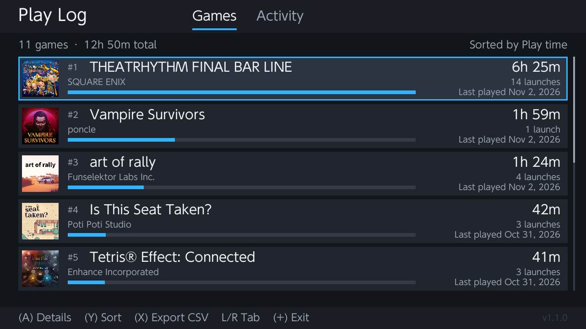
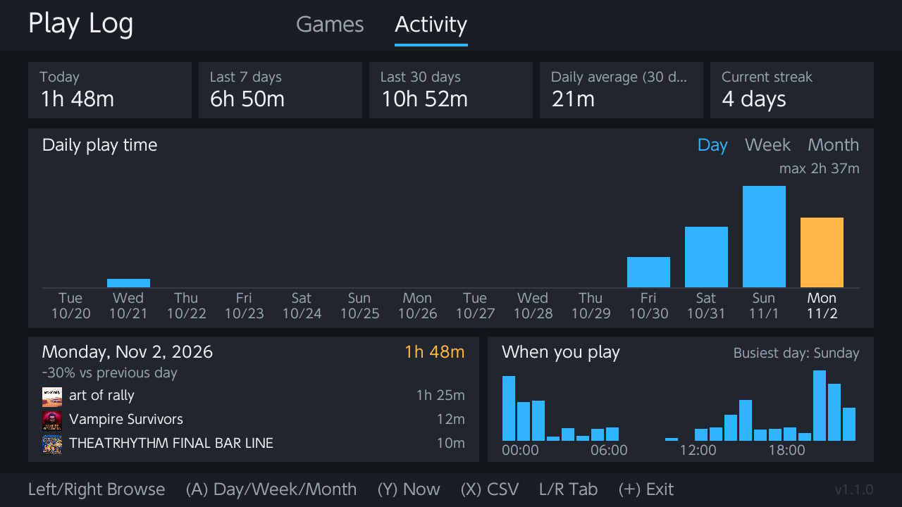

# Play Log

**Download:** grab `PlayLog.nro` from the [Releases](../../releases/latest) page, copy it to
`sdmc:/switch/` on your SD card and open it from the Homebrew Menu (needs Atmosphère).

A play-activity log for Nintendo Switch / Switch Lite, in the spirit of the 3DS Activity Log.
It reads the console's own play records (the `pdm` service), so your whole history shows up right away,
including games you've since deleted.




## Compatibility

- **Consoles:** Switch, Switch OLED and Switch Lite (tested on a Switch Lite).
- **Firmware:** any system version supported by current Atmosphère. Play time is read the right way on both
  older firmware (up to 15.0.1) and 16.0.0 and newer, which changed how the console stores it.
- **Requires** custom firmware (Atmosphère) and the Homebrew Menu. It won't run on an unmodified console.
- Built with libnx 4.12.0.

## Screens

- **Games**: every game you've played, ranked, with icon, total time, launches, last played and a bar.
  `Y` cycles sort: play time, recently played, launches, first played, title.
- **Game details** (`A`): total time, launches, average per launch, longest session, days played,
  average per day played, first/last played, a 30-day daily chart (`Left`/`Right` shifts by 30 days),
  and recent sessions. `Up`/`Down` jumps to the previous/next game.
- **Activity** (`L`/`R`): today, last 7 / 30 days, daily average and play streak, plus a chart you can browse
  by **day, week or month** (`A` switches). `Left`/`Right` steps back and forward through previous periods,
  `Up`/`Down` jumps a whole chart, `Y` returns to now. The selected period shows its total, average per day,
  change vs the previous period and your top games, next to an hour-of-day chart.
- Only official games are counted: homebrew forwarders and unknown titles are left out.
- `ZL`/`ZR` switches user profile, `X` exports a CSV to `sdmc:/switch/PlayLog/`, `−` saves a screenshot there, `+` exits.
- Touch works too: tap to select, tap again to open, drag to scroll.

Totals, launches and first/last dates are the console's official numbers. Daily, session and hour
breakdowns are rebuilt from the event log, so they can be slightly lower than the totals.

## Build (Linux, one-time setup)

```bash
wget https://apt.devkitpro.org/install-devkitpro-pacman
chmod +x ./install-devkitpro-pacman
sudo ./install-devkitpro-pacman
sudo dkp-pacman -S switch-dev switch-sdl2 switch-sdl2_ttf switch-sdl2_image
```

Then, in a new terminal:

```bash
export DEVKITPRO=/opt/devkitpro
make
```

## Install

Copy `PlayLog.nro` to `sdmc:/switch/` and open it from the Homebrew Menu (Atmosphère).
Launching hbmenu through a game (hold `R` while starting a title) gives it more memory than the Album.
